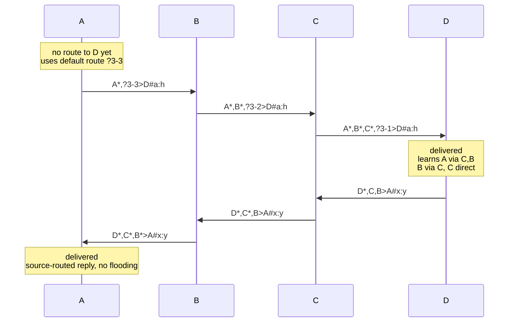

# micro:bit mesh

**A tiny multi-hop mesh network for the BBC micro:bit, in one TypeScript file.**

Messages travel from micro:bit to micro:bit until they reach their destination. You can predefine the route (source routing), let the network flood the message (like APRS digipeaters), or mix both. The receiver learns return routes from incoming packets on its own.


---

## Features

- **Source routing**: the sender names the hops explicitly (`R7*,E5,E9>UP:…`)
- **Flooding with a hop budget**: `?3-3` (each relay adds its callsign) or `!3-3` (anonymous, constant packet size)
- **Route learning**: the receiver learns the return route from the path a packet took
- **Duplicate detection**: an optional sequence number (`#…`), with a fallback to payload comparison (APRS style)
- **Non-blocking**: forwarding uses a jittered background TX queue, so the receive handler never sleeps
- **Transport-agnostic**: you plug in `sendPacket` / `processReceivedPacket`. It works with the micro:bit radio, and other transports such as UWB or BLE are possible.

---

## Quick start

1. Open [makecode.microbit.org](https://makecode.microbit.org), create a new project and switch to **JavaScript**.
2. Paste the contents of [`mesh.ts`](mesh.ts).
3. Give every micro:bit its own name (`let myName = "R7"`) and flash it.
4. Press **A**: the micro:bit sends its name to the station `UP`.

The wiring at the bottom of `mesh.ts` looks like this:

```ts
let myName = "R7";
let mesh = new Mesh(myName);

radio.setGroup(42);

// radio -> mesh
radio.onReceivedString(function (packet: string) {
    mesh.processReceivedPacket(packet);
});

// mesh -> radio
mesh.sendPacket = function (packet: string) {
    radio.sendString(packet);
};

// a message for us has arrived
mesh.onMessageReceived = function (source: string, payload: string) {
    basic.showString(source + ":" + payload);
};

input.onButtonPressed(Button.A, function () {
    if (!mesh.sendMessage("UP", "HI")) {
        basic.showString(mesh.getLastError());
    }
});
```

---

## Packet format

```
PATH>DEST[#SEQ]:PAYLOAD

R7*,!3-3>UP#a:HELLO
└┬┘ └┬─┘ └┬┘└┬┘ └─┬─┘
 │   │    │  │    └── payload: everything after the first ':' (any characters)
 │   │    │  └─────── sequence number (optional, any length)
 │   │    └────────── destination
 │   └─────────────── relay token: flood, max. 3 hops, 3 left
 └─────────────────── source (* = has transmitted)
```

### Path tokens

| Token | Meaning |
|---|---|
| `E5*` | Station E5 **has already transmitted** the packet. The first entry is always the source. |
| `E9` | **Explicit next hop** (source routing), not yet processed |
| `?max-rest` | **Traced flooding**: any station may relay, inserts `ID*,` in front of the token and decrements `rest` |
| `!max-rest` | **Anonymous flooding**: like `?`, but without the callsign. The packet does not grow. |
| `…-0` | Relay budget exhausted, no further relaying |

> **APRS users:** `*` is the *has-been-repeated* bit, `?3-3` corresponds to `WIDE3-3` (New-N paradigm), and `!3-3` to the old untraced WIDEn-N.

### Reserved characters

Station IDs and sequence numbers must not be empty and must not contain any of `, > : * ? ! #`.

---

## How a packet travels

Four micro:bits in a line, each one only reaches its neighbours. The default route is `?3-3`:



1. **A** has no route to D yet, so it uses the default route `?3-3`.
2. Each relay adds its callsign and decrements the budget.
3. **D** reverses the path and from then on knows how to reach A, B and C.
4. D's reply no longer floods. It takes exactly the path `C,B`.

Learned routes expire after `cacheLifetime` seconds (default 30).

---

## Duplicate detection

Flooding almost always delivers **several copies** of the same packet. A message is identified as follows:

| Packet | Duplicate key | Consequence |
|---|---|---|
| with `#SEQ` | `source > dest # seq` | The same text twice in a row is delivered twice |
| without `#` | `source > dest : payload` | Identical text within `cacheLifetime` counts as a duplicate (like APRS) |

This applies **at the destination** (`onMessageReceived` fires exactly once) and **at every relay** (each relay forwards a message only once).

```ts
mesh.sendMessage("UP", "HI");           // automatic sequence number (seqLength chars)
mesh.sendMessage("UP", "HI", "12345");  // your own sequence number
mesh.sendMessage("UP", "HI", "");       // no sequence number (APRS style)
```

---

## API

### `new Mesh(stationID: string, maxPacketSize = 19)`
Creates a node. An invalid `stationID` triggers `control.panic(801)`.

### Methods

| Method | Description |
|---|---|
| `sendMessage(dest, payload, seq?)` → `boolean` | Sends a message. Returns `false` if it does not fit (`getLastError()`). |
| `processReceivedPacket(packet)` | Feed a received raw packet into the mesh |
| `setDefaultRoute(route)` | Route for unknown destinations, e.g. `"!3-3"` or `"?3-3"`. Clears the routing table. |
| `getLastError()` → `string` | Last error (`"Packet too big"`, `"Bad destination"`, …) |

### Callbacks

| Callback | Description |
|---|---|
| `onMessageReceived(source, payload)` | Called once per message addressed to this node |
| `sendPacket(packet)` | Called when the mesh wants to transmit. Connect it to your radio. |

### Settings

| Property | Default | Meaning |
|---|---|---|
| `maxJitterMs` | `1000` | Random delay before relaying (collision avoidance) |
| `cacheLifetime` | `30` | Seconds that routes and duplicate entries stay valid |
| `seqLength` | `1` | Length of the automatic sequence number (0–4 chars, base 62) |
| `maxQueueLength` | `16` | Maximum number of packets in the TX queue (the oldest is dropped) |

---

## Packet budget

`radio.sendString` carries at most **19 characters**, and the header takes part of that:

| Header | Length | Payload left |
|---|---|---|
| `R7*>UP#a:` (direct) | 9 | **10** |
| `R7*,!3-3>UP#a:` (anonymous flooding) | 14 | **5** |
| `R7*,!3-3>UP:` (no SEQ) | 12 | **7** |
| `A*,B*,C*,?3-0>D#a:` (3 traced relays) | 18 | **1** |

That is why the default route is `!3-3`: its size stays the same on every hop. If inserting the callsign at a `?` relay would overflow the packet, the relay automatically falls back to `!`. The packet still arrives, but the receiver learns no route from it.

> **Tip:** On transports with larger frames (e.g. UWB, 127 bytes per 802.15.4 frame), raise `maxPacketSize` and use `?` relays everywhere.

---

## Limitations

- **No security**: anyone can claim any source. There is no authentication or encryption.
- **No end-to-end ACK**: delivery is best effort. If you need one, build it into your application (e.g. reply with `ack<seq>`).
- **Sequence number wrap-around**: with `seqLength = 1`, at most 62 messages per source and destination fit into `cacheLifetime`.
- **Bounded caches**: 32 entries each for relays and deliveries. At very high message rates, old entries are dropped early.
- **Not compatible with older versions** when `#SEQ` is used. To reach old nodes, send with `seq = ""`.

---

## Testing

The routing logic was tested on a PC: `mesh.ts` with small stubs for `control`, `basic` and `randint`, simulated over several virtual nodes with configurable topologies in Node.js. The tests cover delivery over multiple hops, route learning, duplicate filtering, relay budgets, the `?`→`!` fallback and malformed packets. The file also compiles unchanged with the official MakeCode compiler (`pxt-microbit`).

---

## License

MIT – free to use, modify and share, also commercially.
Developed in class together with students at the HTL Leoben.
